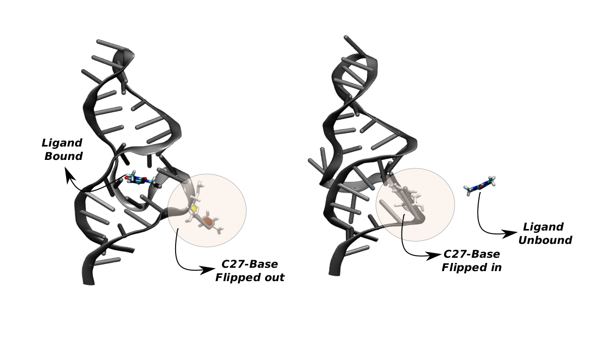

# Enhanced Sampling of ligand binding coupled to the RNA Base Flipping dynamics

Code to reproduce the paper [Enhanced Sampling of ligand binding coupled to the RNA Base Flipping dynamics]  

ChemRxiv: 

The analysis scripts were taken from the following repositories:

FESTA.py: https://github.com/vi-rwth/FESTA (Valentin Istomin and GiovanniMaria Piccini)

funnel_FES_from_Reweighting.py: https://github.com/valeriorizzi/Deep-LDA_LigandBinding_SAMPL5/tree/correction_NL (Valerio Rizzi)
